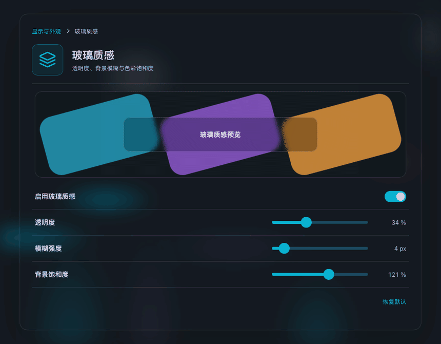

# LuminaKit

[English](README.md) | [简体中文](README.zh-CN.md)

Premium soft / translucent / light-forward UI components.
Minimal, high-key, built for calm product interfaces.

SwiftUI for native, plain HTML/CSS/JS for the web. No web dependencies.

## Components

| Component | Platform | Description | Preview |
|---|---|---|---|
| **IridescentBlob** | SwiftUI | Translucent pearl blob with liquid folds, thin-film iridescence, soft high-gloss lighting | [GIF](Docs/Assets/iridescent-blob.gif) · [MP4](Docs/Assets/iridescent-blob.mp4) |
| **GlowButton** | Web | Button whose soft glow and rim highlight track the pointer | [GIF](Docs/Assets/glow-button.gif) |
| **GlassPanel** | Web | Frosted-glass surface with a refracted rim, specular hairline and grain | [GIF](Docs/Assets/glass-appearance.gif) · [PNG](Docs/Assets/glass-appearance.png) |

---

## IridescentBlob — SwiftUI

https://github.com/user-attachments/assets/2d0a54fe-cfac-43f4-9cd3-441d9c33a029

**Requirements:** iOS 17+ / macOS 14+ / tvOS 17+ / visionOS 1+, Metal

**Install** — Xcode → *File → Add Package Dependencies…*

```
https://github.com/chen123aaa/LuminaKit.git
```

**Usage**

```swift
import LuminaKit

IridescentBlobView()                       // default
IridescentBlobView(morph: 1.2, speed: 0.8)
```

| Parameter | Type | Default | Meaning |
|---|---|---|---|
| `morph` | `Float` | `1.0` | Fold intensity (`0.4…1.4`) |
| `speed` | `Float` | `1.0` | Playback rate (`0.4…1.8`) |

---

## GlowButton — Web


A button whose glow follows the cursor, with a short trailing lag so the light
feels like it has weight. Soft radial glow, rim highlight and a specular dot all
track the pointer.

**Install** — copy the two files, or reference them directly:

```html
<link rel="stylesheet" href="web/glow-button/lumina-glow-button.css">
<script src="web/glow-button/lumina-glow-button.js"></script>

<button class="lg-btn">Continue</button>
```

The script auto-initialises every `.lg-btn` on the page.

**Tune it with CSS custom properties**

```css
.lg-btn {
  --lg-glow: 111 199 255;   /* glow color as "r g b" */
  --lg-glow-size: 160;      /* trailing glow radius, px */
  --lg-glow-alpha: 1;       /* 0–1 strength */
  --lg-radius: 14;          /* corner radius, px */
}
```

Add `.lg-btn--light` when the button sits on a light backdrop.

**Single file:** [`web/glow-button/standalone.html`](web/glow-button/standalone.html)
holds the component and a demo in one file — copy it anywhere and open it.

**Demo:** open [`web/index.html`](web/index.html).

---

## GlassPanel — Web



*The glass recipe applied to a real settings sheet — live preview, opacity /
blur / saturation. The page itself: [`web/examples/glass-appearance/index.html`](web/examples/glass-appearance/index.html).*

Frosted glass in the spirit of Apple's materials. It is layered like real glass
rather than being one translucent fill: a heavy backdrop blur with a saturation
boost, a **refracted band along the rim** that blurs the backdrop harder so the
sheet reads as thick, a crisp specular hairline, fine grain so wide gradients do
not band, and layered elevation shadows.

Pure CSS — the script only adds the optional pointer sheen.

```html
<link rel="stylesheet" href="web/glass-panel/lumina-glass-panel.css">
<script src="web/glass-panel/lumina-glass-panel.js"></script>

<div class="lg-panel">…</div>
```

Thickness: `.lg-panel--thin` · `.lg-panel--thick` · light surfaces:
`.lg-panel--light` · pointer sheen: `.lg-panel--sheen`.

**Tune it with CSS custom properties**

```css
.lg-panel {
  --lgp-blur: 30;                 /* backdrop blur, px */
  --lgp-saturate: 180;            /* backdrop saturation, % */
  --lgp-bg: rgba(26,28,36,.46);   /* tint of the glass */
  --lgp-radius: 22;               /* corner radius, px */
  --lgp-edge: 14;                 /* refracted rim, 0 disables it */
  --lgp-grain: .16;               /* 0 disables grain */
}
```

A panel needs a real backdrop to sit over — `backdrop-filter` only shows what is
painted behind the element, so over a flat fill it looks like a plain
translucent box. It also honours `prefers-reduced-transparency`.

**Single file:** [`web/glass-panel/standalone.html`](web/glass-panel/standalone.html)
holds the component and a demo in one file — copy it anywhere and open it.

**Demo:** open [`web/index.html`](web/index.html).

---

## Examples

[**Glass Appearance — settings sheet**](web/examples/glass-appearance/index.html)
puts the same glass recipe on a real settings sheet: a live preview over three
colour bars, opacity / blur / saturation controls whose value is persisted, and
both the `prefers-reduced-transparency` and no-`backdrop-filter` fallbacks
wired up. One self-contained file that runs offline.

It keeps its own `--glass-*` variables because it mirrors an actual settings
schema rather than a component API: `--glass-opacity`, `--glass-blur` and
`--glass-saturation` map to `--lgp-bg`'s alpha, `--lgp-blur` and
`--lgp-saturate`.

---

## Design notes

- Soft SDF blob + domain-warped ridged noise (liquid folds)
- Thin-film iridescence biased to silhouette edges and creases
- High-key milk-white base, no harsh shadows
- Glow follows with a lerped pointer so the light trails instead of snapping
- Glass is built from layers (refracted rim → grain → sheen → content) rather
  than one translucent fill, which is what separates real frosted glass from a
  low-opacity box

## License

[MIT](LICENSE)
