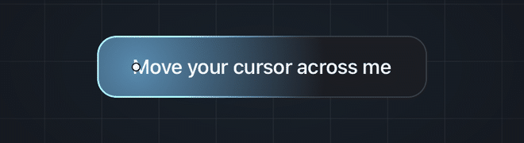
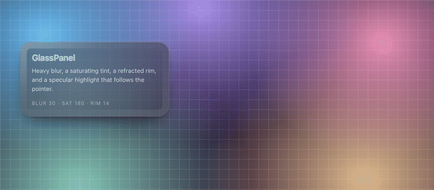

# LuminaKit

[English](README.md) | [简体中文](README.zh-CN.md)

偏高级质感的 UI 组件库：半透明、软材质、光效。
极简、高调，为安静的产品界面而生。

原生用 SwiftUI，网页用纯 HTML/CSS/JS，无任何前端依赖。

## 组件

| 组件 | 平台 | 说明 | 预览 |
|---|---|---|---|
| **IridescentBlob** | SwiftUI | 半透明珍珠软球：流体褶皱、薄膜虹彩、柔和高光 | [GIF](Docs/Assets/iridescent-blob.gif) · [MP4](Docs/Assets/iridescent-blob.mp4) |
| **GlowButton** | Web | 光标跟随光效按钮：柔光 + 边缘高光随指针移动 | [GIF](Docs/Assets/glow-button.gif) |
| **GlassPanel** | Web | 毛玻璃面板：边缘折射带 + 发丝高光 + 细颗粒 | [GIF](Docs/Assets/glass-panel.gif) · [PNG](Docs/Assets/glass-panel.png) |

---

## IridescentBlob — SwiftUI

https://github.com/user-attachments/assets/2d0a54fe-cfac-43f4-9cd3-441d9c33a029

**环境要求**：iOS 17+ / macOS 14+ / tvOS 17+ / visionOS 1+，需要 Metal

**安装** — Xcode → *File → Add Package Dependencies…*

```
https://github.com/chen123aaa/LuminaKit.git
```

**用法**

```swift
import LuminaKit

IridescentBlobView()                       // 默认
IridescentBlobView(morph: 1.2, speed: 0.8)
```

| 参数 | 类型 | 默认 | 说明 |
|---|---|---|---|
| `morph` | `Float` | `1.0` | 褶皱强度（`0.4…1.4`） |
| `speed` | `Float` | `1.0` | 播放速度（`0.4…1.8`） |

---

## GlowButton — Web



鼠标滑过时，柔光与边缘高光跟随指针移动，并带一点延迟拖尾，让光有重量感。
径向柔光、描边高光和光标处的高光点三层一起跟随。

**安装** — 复制这两个文件，或直接引用：

```html
<link rel="stylesheet" href="web/glow-button/lumina-glow-button.css">
<script src="web/glow-button/lumina-glow-button.js"></script>

<button class="lg-btn">继续</button>
```

脚本会自动初始化页面上所有 `.lg-btn`。

**用 CSS 变量调整**

```css
.lg-btn {
  --lg-glow: 111 199 255;   /* 光效颜色，"r g b" */
  --lg-glow-size: 160;      /* 拖尾柔光半径，px */
  --lg-glow-alpha: 1;       /* 0–1 强度 */
  --lg-radius: 14;          /* 圆角，px */
}
```

按钮位于浅色背景时，加 `.lg-btn--light`。

**单文件版**：[`web/glow-button/standalone.html`](web/glow-button/standalone.html)
把组件和演示合在一个文件里，拷到哪里都能直接打开。

**演示**：打开 [`web/index.html`](web/index.html)。

---

## GlassPanel — Web



苹果那种毛玻璃。它不是"一块半透明填充"，而是像真玻璃一样分层叠出来的：
高强度的背景模糊 + 饱和度提升、**边缘的折射带**（在边缘再叠一层更强模糊，
让玻璃看起来有厚度）、顶部的发丝高光、细颗粒噪点（避免大面积极渐变出现色带）、
以及分层投影。

纯 CSS 实现，脚本只负责可选的指针高光。

```html
<link rel="stylesheet" href="web/glass-panel/lumina-glass-panel.css">
<script src="web/glass-panel/lumina-glass-panel.js"></script>

<div class="lg-panel">…</div>
```

厚度：`.lg-panel--thin` · `.lg-panel--thick`；浅色背景：`.lg-panel--light`；
指针高光：`.lg-panel--sheen`。

**用 CSS 变量调整**

```css
.lg-panel {
  --lgp-blur: 30;                 /* 背景模糊，px */
  --lgp-saturate: 180;            /* 背景饱和度，% */
  --lgp-bg: rgba(26,28,36,.46);   /* 玻璃底色 */
  --lgp-radius: 22;               /* 圆角，px */
  --lgp-edge: 14;                 /* 边缘折射带宽度，0 关闭 */
  --lgp-grain: .16;               /* 0 关闭颗粒 */
}
```

面板需要真实的背景垫在下面——`backdrop-filter` 只作用于元素背后已经绘制的内容，
放在纯色块上就只是一块半透明方块。同时支持 `prefers-reduced-transparency`。

**单文件版**：[`web/glass-panel/standalone.html`](web/glass-panel/standalone.html)
把组件和演示合在一个文件里，拷到哪里都能直接打开。

**演示**：打开 [`web/index.html`](web/index.html)。

---

## 设计要点

- 软 SDF 球体 + domain-warped 脊线噪声（流体褶皱）
- 薄膜虹彩集中在轮廓边缘与褶皱棱线
- 高调乳白基底，无硬阴影
- 光效跟随使用插值缓动，产生拖尾而不是瞬间吸附
- 玻璃按层叠出来（边缘折射带 → 颗粒 → 高光 → 内容），而不是一块半透明填充；
  这是"毛玻璃"和"低不透明度方块"的区别所在

## 许可证

[MIT](LICENSE)
