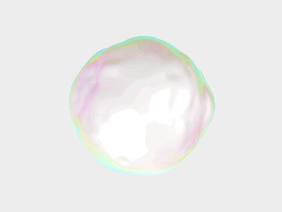

# LuminaKit

[English](README.md) | [简体中文](README.zh-CN.md)

偏高级质感的 SwiftUI 组件库：半透明、软材质、光效与流体形态。

极简、高调、为安静的产品界面而生。



## 组件

| 组件 | 说明 | 预览 |
|---|---|---|
| **IridescentBlob** | 半透明珍珠软球：流体褶皱、薄膜虹彩、柔和高光 | [GIF](Docs/Assets/iridescent-blob.gif) · [MP4](Docs/Assets/iridescent-blob.mp4) · [PNG](Preview/iridescent-blob.png) |

后续组件会陆续加入本仓库。

## 环境要求

- iOS 17+ / macOS 14+ / tvOS 17+ / visionOS 1+
- Metal

## 安装

### Swift Package Manager

Xcode：**File → Add Package Dependencies…**

```
https://github.com/chen123aaa/LuminaKit.git
```

或在 `Package.swift` 中：

```swift
.package(url: "https://github.com/chen123aaa/LuminaKit.git", from: "0.1.0")
```

## 用法

```swift
import LuminaKit

struct ContentView: View {
    var body: some View {
        IridescentBlobView()
            .ignoresSafeArea()
    }
}
```

### 参数

| 参数 | 类型 | 默认 | 说明 |
|---|---|---|---|
| `morph` | `Float` | `1.0` | 褶皱强度（`0.4…1.4`） |
| `speed` | `Float` | `1.0` | 播放速度（`0.4…1.8`） |

```swift
IridescentBlobView(morph: 1.2, speed: 0.8)
```

## 设计要点

- 软 SDF 球体 + domain-warped 脊线噪声（流体褶皱）
- 薄膜虹彩主要落在轮廓边缘与褶皱棱线
- 高调乳白基底，无硬阴影
- 浅冷灰底（`#F2F2F3`），适配安静 UI 画布

## 示例工程

`Demo/IridescentBlobDemo.swift` 可直接作为 macOS / iOS 的 `@main` App 运行。

## 许可证

[MIT](LICENSE)
